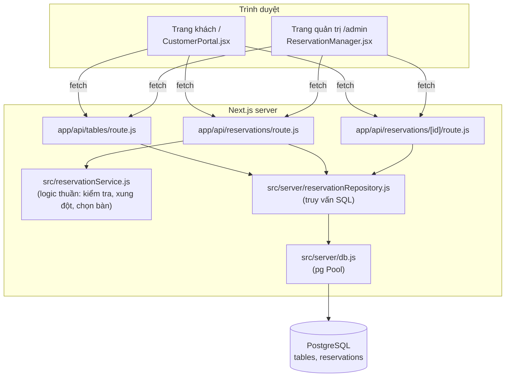
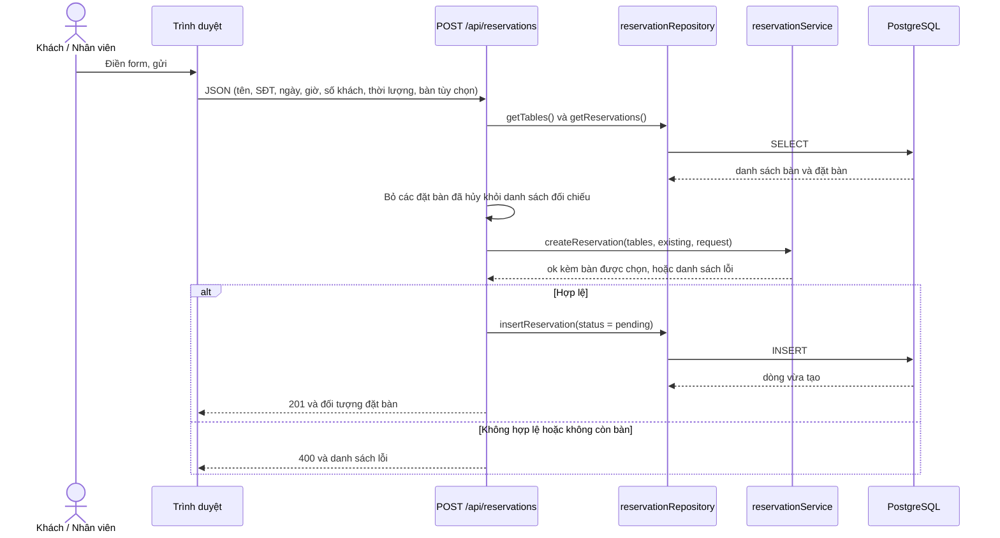
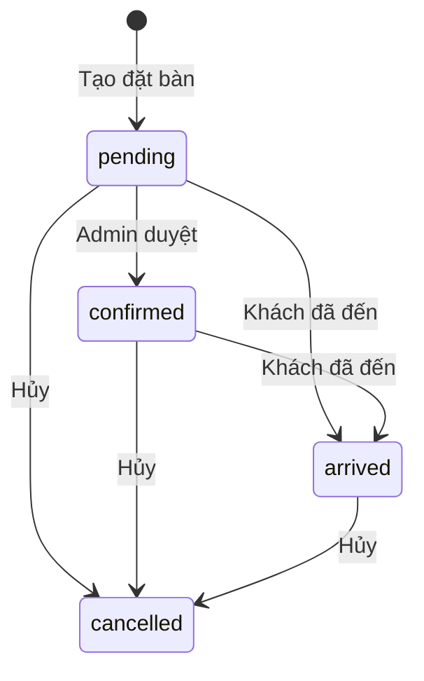

## 1. Công nghệ

| Thành phần | Công nghệ |
|---|---|
| Web và API | Next.js 16 (App Router, Route Handlers), React 19 |
| Cơ sở dữ liệu | PostgreSQL 16 (Docker Compose, cổng máy chủ `5433`) |
| Truy cập database | Thư viện `pg` (`Pool`), không dùng ORM |
| Kiểm thử | `node --test` (bộ chạy test có sẵn của Node) |
| Lint | ESLint 10 với `eslint-config-next` |
| CI | GitHub Actions |

## 2. Các lớp

## 3. Cấu trúc thư mục

| Đường dẫn | Vai trò |
|---|---|
| `app/page.js` | Trang khách, hiển thị `CustomerPortal` |
| `app/admin/page.js` | Trang quản trị, hiển thị `ReservationManager` |
| `app/components/CustomerPortal.jsx` | Form đặt bàn, tra cứu theo số điện thoại, hủy đặt bàn |
| `app/components/ReservationManager.jsx` | Form tạo đặt bàn, sơ đồ bàn, danh sách duyệt, tra cứu |
| `app/api/tables/route.js` | `GET` danh sách bàn |
| `app/api/reservations/route.js` | `GET` danh sách đặt bàn, `POST` tạo đặt bàn |
| `app/api/reservations/[id]/route.js` | `PATCH` đổi trạng thái |
| `src/reservationService.js` | Logic nghiệp vụ thuần (không truy cập database) |
| `src/server/db.js` | Tạo `Pool` từ biến môi trường `DATABASE_URL` |
| `src/server/reservationRepository.js` | Các hàm truy vấn: `getTables`, `getReservations`, `insertReservation`, `updateReservationStatus` |
| `docker/postgres/init/01-init.sql` | Tạo bảng, index, dữ liệu mẫu (chạy khi khởi tạo volume lần đầu) |
| `test/reservationService.test.js` | Test cho logic thuần |
| `.github/workflows/ci.yml` | Pipeline CI |
| `docs/` | Tài liệu dự án |

## 4. Luồng tạo đặt bàn

Điểm cần lưu ý: bước đọc dữ liệu, kiểm tra và ghi **không nằm trong một transaction**, nên hai yêu cầu đồng thời có thể cùng giữ một bàn (mục V01 trong [code-review.md](code-review.md)).

## 5. Quy tắc nghiệp vụ hiện có

**Kiểm tra dữ liệu** (`validateReservationRequest`):

- Tên khách: chuỗi, sau khi cắt khoảng trắng đầu cuối có ít nhất 2 ký tự.
- Số điện thoại: chuỗi khớp `^0\d{9}$` (10 chữ số, bắt đầu bằng 0).
- Số khách: số nguyên từ 1 trở lên.
- Thời lượng: số nguyên từ 30 phút trở lên.
- Ngày: chuỗi mà `Date.parse` hiểu được.
- Giờ: dạng `HH:MM`, giờ 00 đến 23, phút 00 đến 59.

**Xung đột lịch** (`hasReservationConflict`): hai đặt bàn xung đột khi **cùng ngày** và khoảng thời gian giao nhau theo công thức `bắtĐầuMới < kếtThúcCũ` và `bắtĐầuCũ < kếtThúcMới`. Kết thúc đúng lúc bắt đầu thì không xung đột. Chỉ so sánh trong cùng một ngày.

**Chọn bàn** (`createReservation`):

- Nếu yêu cầu có `tableId`: kiểm tra bàn tồn tại, đủ sức chứa và không trùng lịch; nếu không thì trả lỗi tương ứng.
- Nếu không có `tableId`: `findAvailableTable` chọn bàn **nhỏ nhất đủ chỗ** (sắp theo sức chứa tăng dần) và không trùng lịch.
- Đặt bàn đã hủy (`cancelled`) không được tính khi kiểm tra xung đột (lọc ở `app/api/reservations/route.js`).

## 6. Trạng thái đặt bàn

Giá trị hợp lệ: `pending`, `confirmed`, `arrived`, `cancelled`. Đặt bàn mới luôn được lưu với `pending`.

Sơ đồ trên là các nút bấm mà giao diện đang cho phép. **API không ràng buộc luồng này**: `PATCH` nhận bất kỳ trạng thái hợp lệ nào cho bất kỳ đặt bàn nào (mục V06 trong [code-review.md](code-review.md)).

## 7. Hạn chế đã biết

Xem danh sách đầy đủ, kèm vị trí trong mã và hướng khắc phục, tại [code-review.md](code-review.md). Các điểm đáng chú ý nhất liên quan đến kiến trúc: không có xác thực, kiểm tra trùng lịch không nằm trong transaction, và ngày đọc từ database có thể lệch theo múi giờ của máy chạy server.
