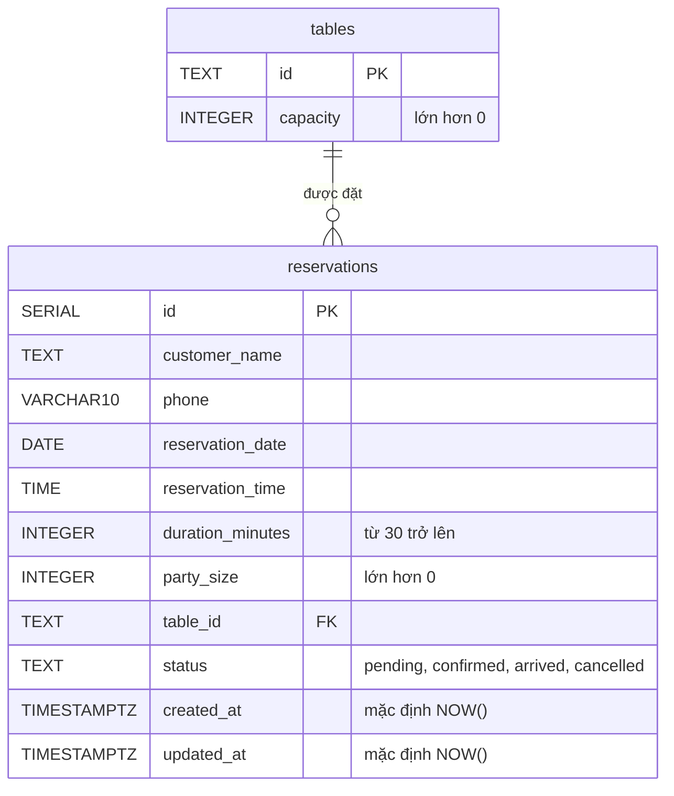

## 1. Sơ đồ quan hệ



## 2. Bảng `tables`

| Cột | Kiểu | Ràng buộc |
|---|---|---|
| `id` | `TEXT` | Khóa chính |
| `capacity` | `INTEGER` | `NOT NULL`, `CHECK (capacity > 0)` |

## 3. Bảng `reservations`

| Cột | Kiểu | Ràng buộc |
|---|---|---|
| `id` | `SERIAL` | Khóa chính |
| `customer_name` | `TEXT` | `NOT NULL` |
| `phone` | `VARCHAR(10)` | `NOT NULL` |
| `reservation_date` | `DATE` | `NOT NULL` |
| `reservation_time` | `TIME` | `NOT NULL` |
| `duration_minutes` | `INTEGER` | `NOT NULL`, `CHECK (duration_minutes >= 30)` |
| `party_size` | `INTEGER` | `NOT NULL`, `CHECK (party_size > 0)` |
| `table_id` | `TEXT` | `NOT NULL`, khóa ngoại tới `tables(id)` |
| `status` | `TEXT` | `NOT NULL`, `CHECK (status IN ('pending', 'confirmed', 'arrived', 'cancelled'))` |
| `created_at` | `TIMESTAMPTZ` | `NOT NULL`, mặc định `NOW()` |
| `updated_at` | `TIMESTAMPTZ` | `NOT NULL`, mặc định `NOW()`; được cập nhật khi đổi trạng thái |

## 4. Chỉ mục

| Tên | Cột | Dùng cho |
|---|---|---|
| `idx_reservations_phone` | `phone` | Tra cứu theo số điện thoại |
| `idx_reservations_slot` | `reservation_date, reservation_time` | Truy vấn theo khung giờ |

## 5. Dữ liệu mẫu

Bàn: `T1` (2 chỗ), `T2` (4 chỗ), `T3` (6 chỗ), `T4` (8 chỗ).

Hai đặt bàn mẫu, đều ngày `2026-10-17`:

| Khách | Số điện thoại | Giờ | Thời lượng | Số khách | Bàn | Trạng thái |
|---|---|---|---|---|---|---|
| Trần Minh | 0912345678 | 18:00 | 90 phút | 4 | T2 | `pending` |
| Lê Hương | 0987654321 | 19:30 | 120 phút | 2 | T1 | `confirmed` |

## 6. Điều cần biết

- **Database không ngăn đặt trùng bàn.** Việc kiểm tra xung đột hoàn toàn nằm ở mã ứng dụng (xem [architecture.md](architecture.md)), không có ràng buộc nào ở database chặn hai đặt bàn chồng giờ trên cùng một bàn (mục V01 trong [code-review.md](code-review.md)).
- **Script khởi tạo chỉ chạy khi volume còn trống.** Image PostgreSQL chỉ thực thi các file trong `docker-entrypoint-initdb.d` lần đầu volume `postgres_data` được tạo. Sửa `01-init.sql` rồi chạy lại `npm run db:up` sẽ **không** áp dụng thay đổi.
- **Thao tác dữ liệu qua ứng dụng, không xóa dòng.** Hủy đặt bàn được ghi bằng cách đổi `status` thành `cancelled`, không xóa dòng.
- **Cột `DATE` và múi giờ.** Khi đọc `reservation_date`, mã hiện dùng `toISOString().slice(0, 10)`, có thể làm ngày lệch một ngày trên máy chạy server có múi giờ phía đông UTC (mục V04 trong [code-review.md](code-review.md)). Khi kiểm tra trực tiếp trong database, ngày lưu vẫn là giá trị đúng.

## 7. Thao tác thường dùng (môi trường cục bộ)

Mở `psql` trong container:

```bash
docker exec -it khkt-postgres psql -U restaurant_user -d restaurant_admin
```

Xem dữ liệu:

```sql
SELECT * FROM tables;
SELECT id, customer_name, reservation_date, reservation_time, table_id, status
FROM reservations
ORDER BY reservation_date, reservation_time;
```

**Tạo lại database từ đầu (xóa toàn bộ dữ liệu cục bộ):**

```bash
docker compose down -v
npm run db:up
```

Tùy chọn `-v` xóa luôn volume `postgres_data`, nghĩa là **mất toàn bộ dữ liệu trong database cục bộ**. Chỉ dùng trên máy của bạn, và chỉ khi chủ động muốn khởi tạo lại. Lệnh `npm run db:down` (không có `-v`) chỉ tắt container và giữ dữ liệu.
