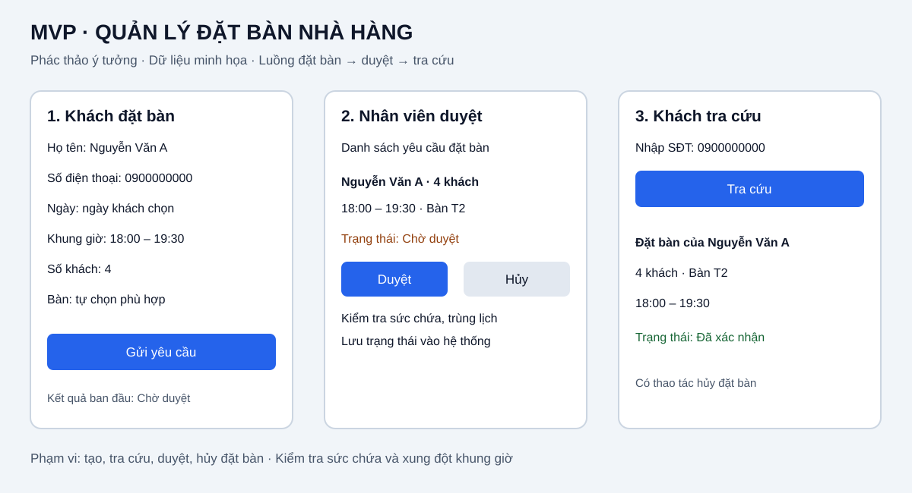

# Tổ chức nhóm theo Scrum và backlog Sprint 0

Repo nhóm: [https://github.com/fngdng/khkt](https://github.com/fngdng/khkt).

## 1. Thống nhất quy trình

Nhóm chọn **Scrum** làm quy trình phát triển đồ án **Hệ thống quản lý đặt bàn nhà hàng**, vận dụng nội dung đã học ở Buổi 4. Nhóm dùng Sprint 0 để chuẩn bị phạm vi MVP, môi trường, backlog và bản demo ban đầu; các Sprint tiếp theo dự kiến kéo dài một tuần.

- Sprint Planning: chọn các việc ưu tiên, chốt mục tiêu và người phụ trách.
- Daily Scrum: cập nhật ngắn hằng ngày về tiến độ, kế hoạch và trở ngại.
- Sprint Review: demo kết quả, tiếp nhận góp ý của lớp và giảng viên.
- Sprint Retrospective: thống nhất điều cần cải thiện cho Sprint sau.
- Theo dõi công việc trên GitHub Issues/Projects theo các cột Todo → In progress → Review → Done; thay đổi mã nguồn và tài liệu qua Pull Request để thành viên khác review.

Sprint 0 là giai đoạn chuẩn bị do nhóm sử dụng, không phải một sự kiện chính thức của Scrum. Backend, frontend và tài liệu là phân công chuyên môn trong nhóm Developers. Nhóm chưa phân công Product Owner; cần thống nhất người chịu trách nhiệm sắp xếp Product Backlog trước Sprint phát triển đầu tiên.

## 2. Bảng phân vai trò

| Thành viên | MSSV | Vai trò / phụ trách | Trách nhiệm |
|---|---|---|---|
| Đặng Thanh Phong | 23110329 | Developer backend; Scrum Master / điều phối | Điều phối các buổi họp, theo dõi tiến độ và trở ngại; xây dựng API, cơ sở dữ liệu, logic gán bàn và kiểm tra trùng lịch; phối hợp tích hợp hệ thống. |
| Phùng Xuân Phúc | 23110211 | Developer frontend | Xây dựng giao diện khách hàng và quản trị; form đặt bàn, tra cứu, danh sách đặt bàn; kết nối API và phối hợp demo. |
| Đỗ Hải Đăng | 23110332 | Báo cáo / tài liệu | Tổng hợp yêu cầu, ghi biên bản và cập nhật backlog; viết hướng dẫn sử dụng, báo cáo, chuẩn bị hình ảnh và kịch bản thuyết trình. |

Các thành viên cùng tham gia làm rõ yêu cầu, review và kiểm thử; người phụ trách chịu trách nhiệm chính cho kết quả của từng việc.

## 3. Backlog Sprint 0

**Mục tiêu:** chốt MVP, chuẩn bị môi trường và có minh họa luồng khách đặt bàn → nhân viên duyệt → khách tra cứu trạng thái.

**Phạm vi MVP:** tạo đặt bàn, chọn hoặc tự gán bàn theo sức chứa và khung giờ, tra cứu bằng số điện thoại, duyệt và hủy đặt bàn. Chưa đưa thanh toán, POS và ứng dụng mobile native vào MVP.

Backlog được tách riêng trong [file Excel backlog Sprint 0](backlog-sprint-0.xlsx), gồm 20 đầu việc chia theo nhóm tổ chức, yêu cầu, môi trường, dữ liệu, thiết kế, API, backend, frontend, kiểm thử, tài liệu, demo và nộp bài. Mỗi việc ghi rõ nội dung thực hiện, ưu tiên, người phụ trách, phụ thuộc, đầu ra/minh chứng, tiêu chí nghiệm thu và trạng thái. File có bộ lọc, cố định hàng tiêu đề và ba cột đầu để thuận tiện theo dõi.

Repo đã có mã nguồn cho nhiều chức năng; các mục **Cần rà soát** chỉ được xác nhận hoàn thành sau khi nhóm chạy và kiểm chứng tiêu chí.
P0: cần cho mục tiêu Sprint 0. P1: hoàn thiện phần trình bày. Nhóm chốt thời gian và sức chứa Sprint khi Planning; chưa ấn định ngày hoặc ước lượng thay các thành viên.

**Điều kiện hoàn thành:** đầu ra đáp ứng tiêu chí trong bảng, được ít nhất một thành viên khác rà soát; phần mã nguồn có test/lint phù hợp và chạy được luồng liên quan. Tài liệu có link truy cập được. Chỉ chuyển sang Done khi có bằng chứng tương ứng.

## 4. Demo nhanh MVP

### Minh họa ý tưởng

[Mở ảnh phác thảo MVP](mvp-wireframe.svg). Đây là bản vẽ ý tưởng để trình bày, không phải ảnh chụp ứng dụng đã chạy.

### Kịch bản trình bày 2–3 phút

1. **Giới thiệu:** khách cần đặt bàn trước; nhân viên cần quản lý lịch và tránh trùng bàn. Giới thiệu ba thành viên và phân vai.
2. **Khách đặt bàn:** mở trang khách, nhập tên, số điện thoại, ngày giờ, số khách; chọn bàn hoặc để hệ thống tự chọn; gửi yêu cầu. Kết quả mong đợi: trạng thái chờ duyệt.
3. **Nhân viên xử lý:** mở trang admin, tìm yêu cầu vừa tạo và duyệt. Kết quả mong đợi: trạng thái đã xác nhận.
4. **Khách tra cứu:** dùng đúng số điện thoại để xem trạng thái mới; minh họa hủy nếu còn thời gian.
5. **Kết thúc:** giới thiệu backlog Sprint 0, các việc cần kiểm chứng và nhận góp ý từ lớp.

### Chạy bản MVP trong repo

Làm theo [hướng dẫn chạy ở README](../../README.md#chạy-lần-đầu): chuẩn bị Node.js 20+, Docker, file `.env.local`, chạy `npm install`, `npm run db:up`, rồi `npm run dev`.

- Trang khách: <http://localhost:5000>.
- Trang nhân viên: <http://localhost:5000/admin>.

Các địa chỉ localhost chỉ dùng trên máy đang chạy ứng dụng, không phải link demo công khai. Khi chưa có môi trường chạy, dùng ảnh phác thảo phía trên để demo ý tưởng theo yêu cầu bài nộp.
