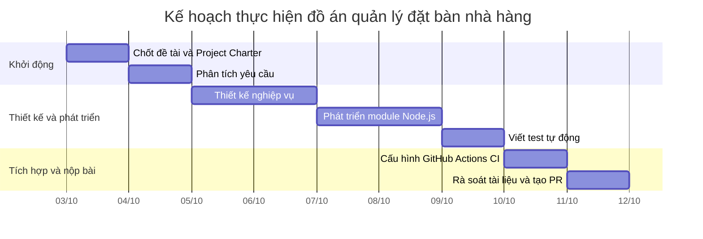

# WBS and Gantt

## WBS

| WBS | Hạng mục               | Kết quả                                                         |
| --- | ------------------------ | ----------------------------------------------------------------- |
| 1.0 | Khởi động dự án     | Xác định mục tiêu, phạm vi, charter                         |
| 1.1 | Phân tích yêu cầu    | Xác định use case đặt bàn cốt lõi                         |
| 1.2 | Lập kiến trúc sơ bộ | Chốt Node.js, luồng dữ liệu, cấu trúc thư mục             |
| 1.3 | Thiết kế nghiệp vụ   | Quy tắc gán bàn, kiểm tra xung đột, trạng thái đặt bàn |
| 2.0 | Phát triển lõi        | Viết module quản lý đặt bàn                                 |
| 2.1 | Viết test               | Test validation, conflict, table assignment                       |
| 2.2 | Thiết lập CI           | GitHub Actions chạy test và lint                                |
| 2.3 | Hoàn thiện tài liệu  | Charter, WBS, Gantt, hướng dẫn chạy                           |
| 3.0 | Hoàn thiện nộp bài   | Review, tạo PR, chụp trạng thái CI xanh                       |

## Gantt

